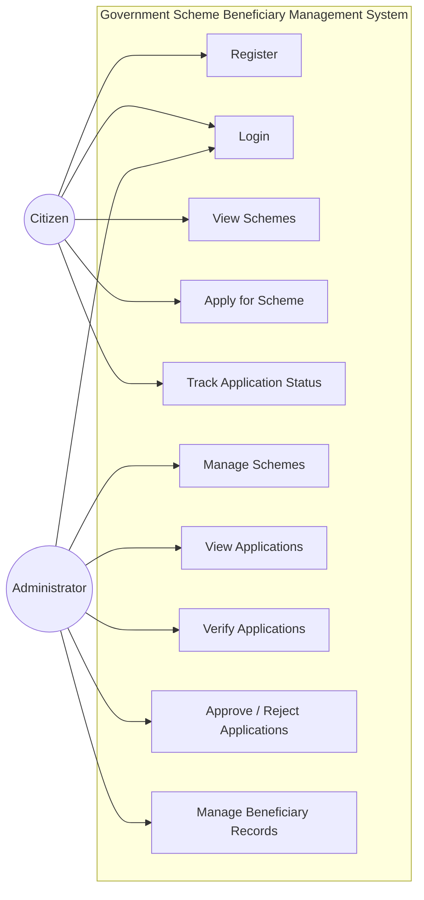
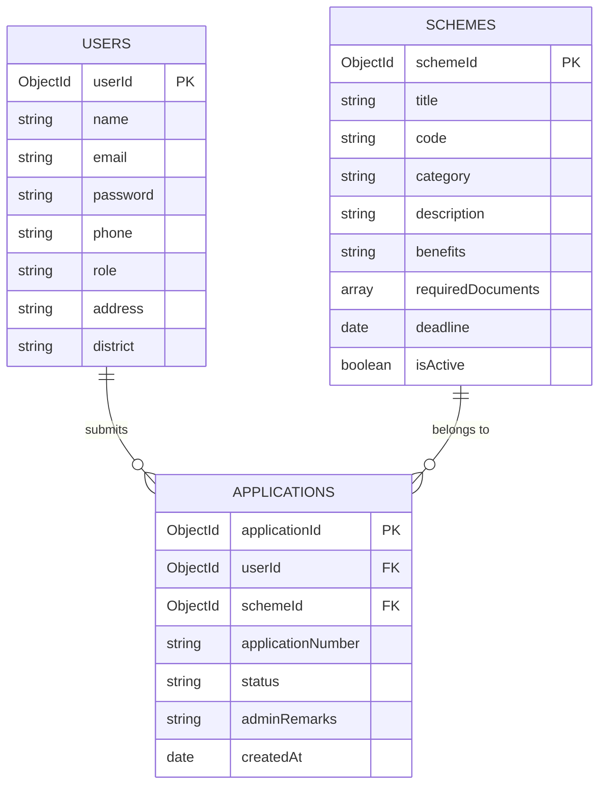
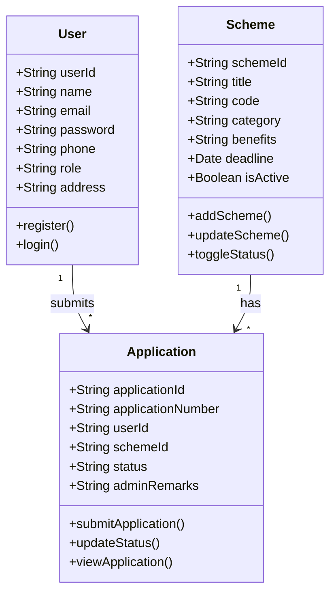
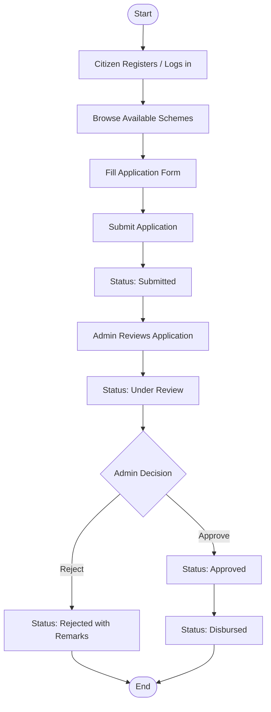
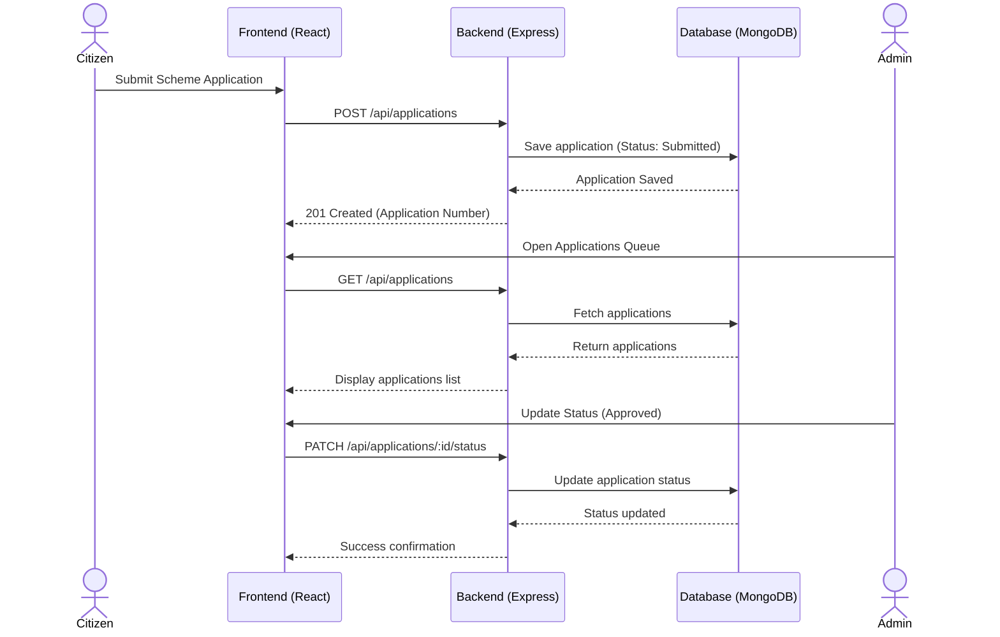

# GOVERNMENT SCHEME BENEFICIARY MANAGEMENT SYSTEM

### BACHELOR OF TECHNOLOGY IN COMPUTER SCIENCE AND ENGINEERING
**Subject:** Full Stack Development – 2 (FSD-2)  
**Academic Year:** 2026–2027  

---

## ABSTRACT :-
The Government Scheme Beneficiary Management System is a web application designed to manage government scheme applications and beneficiary records efficiently.

The system allows citizens to register, log in, view available government schemes, submit applications, and track their application status. The administrator can manage schemes, verify applications, approve or reject applications, and maintain beneficiary records.

The main purpose of this project is to reduce manual work, organize records, and make the government scheme application process easier and more transparent.

---

## PROBLEM STATEMENT :-
Many people face difficulties finding information about government schemes and tracking their applications. Managing applications manually can lead to errors, duplicate records, and delays.

Therefore, we propose a web-based system that provides a centralized platform for managing government schemes, applications, and beneficiary information.

---

## OBJECTIVES :-
* To provide information about available government schemes.
* To allow citizens to apply for government schemes online.
* To maintain application and beneficiary records.
* To help administrators verify applications.
* To allow users to track application status.
* To reduce paperwork and manual errors.
* To provide secure access to users and administrators.

---

## PROJECT OVERVIEW :-
The Government Scheme Beneficiary Management System consists of two main users:

### 1. Citizen (User) :-
The citizen can register, log in, view government schemes, submit applications, and check application status.

### 2. Administrator (Admin) :-
The administrator can add or update schemes, view applications, verify application details, approve or reject applications, and manage beneficiary records.

The system stores all information in a database and allows users to access the relevant information through a web interface.

---

## MAIN MODULES :-

### 1. User Registration and Login
Citizens can create an account and log in using their credentials. Passwords are encrypted with bcrypt and authentication is managed via JWT.

### 2. Government Schemes
Users can view scheme names, categories, eligibility criteria, benefits, and required documents.

### 3. Scheme Application
Users can select a scheme, fill out an application form, verify eligibility criteria, and submit required document records.

### 4. Admin Dashboard
The administrator can manage scheme details (add, edit, close, reopen) and view all submitted citizen applications.

### 5. Application Verification
The administrator scrutinizes submitted claims, verifies documents, and records decisions (Approved or Rejected) with official remarks.

### 6. Application Status Tracking
Citizens can track their application progress across *Submitted*, *Under Review*, *Approved*, *Rejected*, and *Disbursed* stages.

### 7. Beneficiary Management
The administrator maintains records of approved and disbursed beneficiaries and can search and export beneficiary information.

---

## TECHNOLOGY STACK :-

### Frontend:
* React 19
* Vite
* Tailwind CSS

### Backend:
* Node.js
* Express.js

### Database:
* MongoDB
* Mongoose ODM

### Development Tools:
* Visual Studio Code
* Web Browser
* Postman
* Git

The frontend provides the user interface, the backend handles application logic, and MongoDB stores the project data.

---

## UML DIAGRAMS :-

### Use Case Diagram :-


---

### ER Diagram :-


---

### Class Diagram :-


---

### Activity Diagram :-


---

### Sequence Diagram :-


---

## FOLDER STRUCTURE :-
```
c:\FSD II\project\
├── backend/
│   ├── src/
│   │   ├── config/db.js
│   │   ├── models/User.js, Scheme.js, Application.js
│   │   ├── middleware/auth.js, validate.js, errorHandler.js
│   │   ├── controllers/authController.js, schemeController.js, applicationController.js, adminController.js
│   │   ├── routes/authRoutes.js, schemeRoutes.js, applicationRoutes.js, adminRoutes.js
│   │   ├── utils/statusWorkflow.js
│   │   ├── seeds/seed.js
│   │   └── server.js
│   └── package.json
└── frontend/
    ├── src/
    │   ├── api/client.js, authApi.js, schemeApi.js, applicationApi.js, adminApi.js
    │   ├── context/AuthContext.jsx
    │   ├── components/Navbar.jsx, Footer.jsx, StatusBadge.jsx, WorkflowTimeline.jsx, Modal.jsx
    │   ├── pages/HomePage.jsx, SchemeCataloguePage.jsx, SchemeDetailsPage.jsx, LoginPage.jsx,
    │   │         RegisterPage.jsx, ApplicationFormPage.jsx, BeneficiaryDashboardPage.jsx, AdminDashboardPage.jsx
    │   ├── App.jsx
    │   └── main.jsx
    └── package.json
```

---

## IMPLEMENTED SCREENS :-
1. **Home Screen:** Search bar, category quick access, overview metrics, and featured open schemes.
2. **Schemes Catalogue Screen:** Filterable grid with category pills, keyword search, and open/closed filters.
3. **Scheme Details Screen:** Full description, eligibility criteria, benefits summary, and application action.
4. **Registration Screen:** Citizen sign-up form with name, email, password, phone, address, and category.
5. **Login Screen:** User sign-in with email and password, plus quick-login test presets.
6. **Application Form Screen:** Multi-section form capturing applicant details, criteria declarations, and document records.
7. **Beneficiary Dashboard Screen:** List of citizen's submitted applications, status filtering, visual timeline, and printable slip.
8. **Admin Dashboard Screen:** Analytics summary, scheme manager (add/edit/toggle), application review queue, and beneficiary roster.

---

## CONCLUSION & FUTURE SCOPE :-

### Conclusion:
The Government Scheme Beneficiary Management System successfully addresses the challenges of manual application processing. By centralizing scheme management, automating status workflows, and providing transparency for citizens and administrators, the system reduces paperwork, prevents duplication, and accelerates welfare delivery.

### Future Scope:
* SMS and email notification integration for instant status updates.
* Regional language localization (Telugu, Hindi, Tamil).
* Automated eligibility recommendation based on user demographics.

---

## REFERENCES :-
1. React Documentation - https://react.dev
2. Node.js & Express.js Documentation - https://expressjs.com
3. MongoDB Documentation - https://mongodb.com
4. Mongoose Documentation - https://mongoosejs.com
5. Tailwind CSS - https://tailwindcss.com
